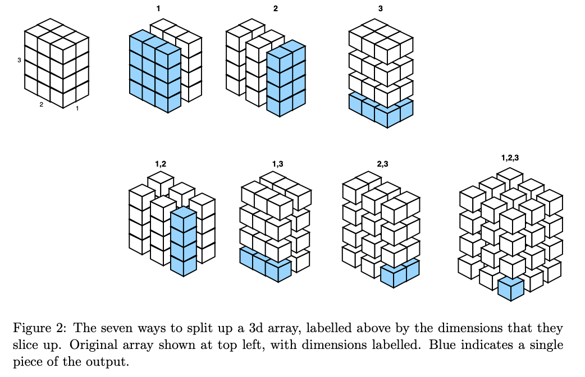
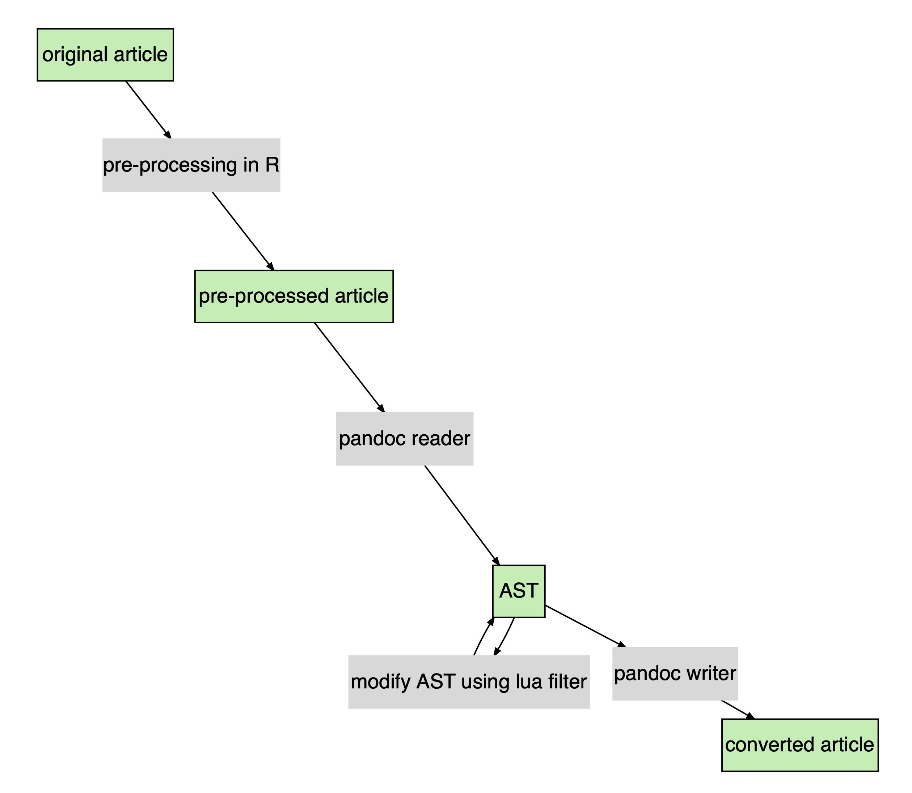
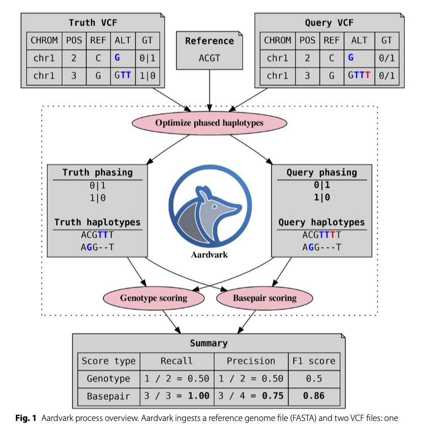
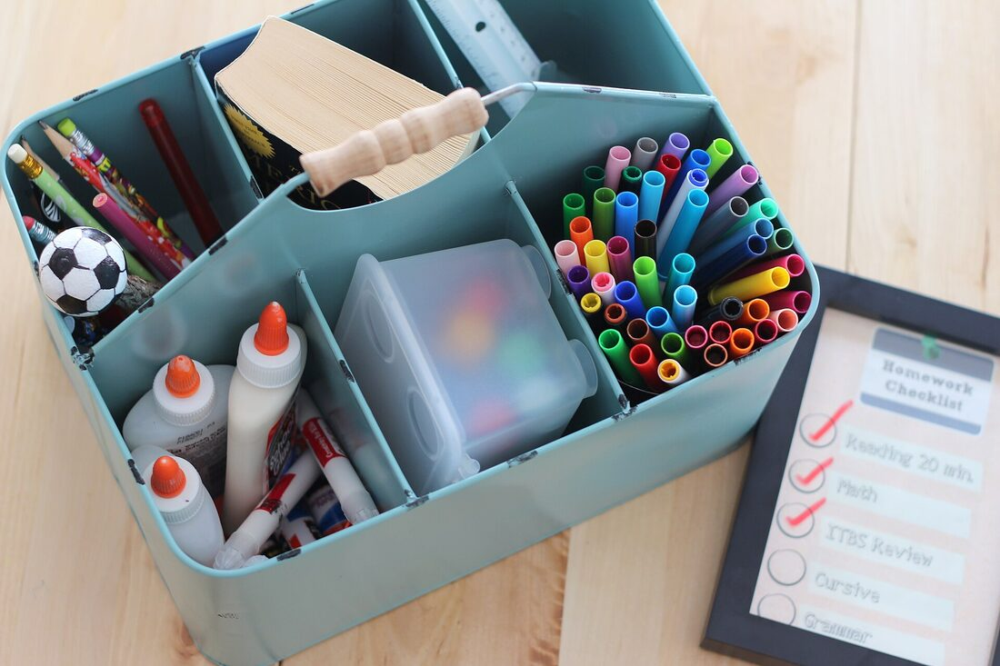
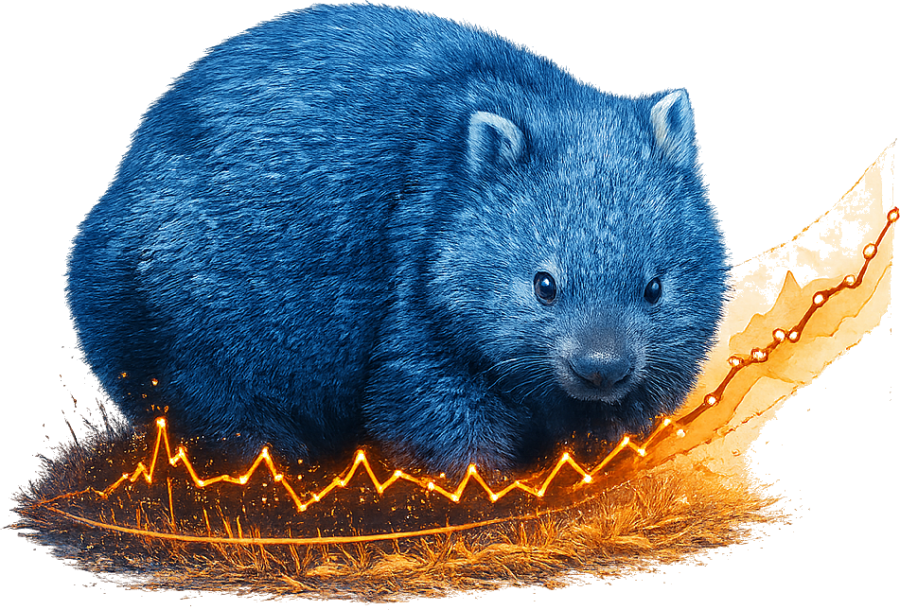

```{r}
#| label: setup
#| include: false
library(ggplot2)
library(tidyr)
library(dplyr)
library(ggdibbler)
library(conflicted)
conflicts_prefer(dplyr::filter)
conflicts_prefer(dplyr::select)
conflicts_prefer(dplyr::slice)
conflicts_prefer(dplyr::rename)
conflicts_prefer(dplyr::mutate)
conflicts_prefer(dplyr::summarise)
options(digits=3, 
        repr.plot.width=15,
        repr.plot.height=8)

# {fig-align="center"}
```

# Session 2 {.transition-slide style="align: center;"}

# Outline


:::: {.columns}

::: {.column}

**Prepare to write your article**

- Putting your work in the context of others
- [Your turn: Lit review]{.monash-blue}
- Guide your reader with a conceptual diagram
- [Your turn: Make a sketch]{.monash-blue}
- Is your software ready?
- [Your turn: Review checklist for your software]{.monash-blue}

:::
::: {.column}

- Publishing best practices

   - Version-controlled collaborative writing
   - Reproducibility of your article
   - Handling big data, or private data
   - Handling slow computation/reproducibility
   - Figure and table captions
   - Adding alt text
  
- Last steps

    - Writing a cover letter
    - Submission instructions

- [Your turn: Write a cover letter]{.monash-blue}

:::
::::

## Placing your software in the right context

- Our work stands on the shoulder of others, and complements other people's work.
- Identify clearly what extra value _your_ software is adding.
- Acknowledge the main alternatives honestly and explain the differences that matter: 
   - design philosophy, 
   - scope, 
   - performance, 
   - ease of use, 
   - size, 
   - learning curve. 

- Focus on trade-offs rather than claiming superiority. 
- A fair comparison builds trust, and a comparison table can work well here.
- **Interoperability and integration**: Cover which tools, frameworks, formats, and languages it works with, and how well. Mention standards it follows, import/export options, and any known compatibility problems.

## Examples: comparisons and alternative software

::: {.panel-tabset}

## JSS

[Wickham (2011) The Split-Apply-Combine Strategy for Data Analysis](https://www.jstatsoft.org/article/view/v040i01)

- APL’s array operators (Friendly and Fox 1994)
- Excel’s pivot tables
- the SQL `group by` operator, and 
- the `by` argument to many SAS procedures

and the motivation section provides a comparison of the new `plyr` code against existing base R code.

## RJ

::: {.f70}

[Ayala et al (2023) asteRisk - Integration and Analysis of Satellite Positional Data in R](https://journal.r-project.org/articles/RJ-2023-023/) doesn't actually have a comparison with other tools, just the sources of data that the R functions wrap. Here are a couple of alternatives that might have been mentioned.

| Criterion      | `asteRisk`                                                              | [`Skyfield`](https://rhodesmill.org/skyfield/)      | [`NASA GMAT`](https://github.com/nasa/GMAT)                 |
| -------------- | ----------------------------------------------------------------------- | --------------------------------------------------- | ------------------------------------------------------------ |
| Design         | R-native scientific toolkit                                             | Simple, Python astronomical API                     | Integrated mission-analysis environment                      |
| Implementation | R, C++ via Rcpp, differential-equation libraries                        | Python with SGP4 and numerical dependencies         | C++ application, GUI and scripting                           |
| Usability      | Good for experienced R users; requires knowledge of orbital conventions | Relatively accessible for programming users         | Graphical entry point, but complex advanced workflows        |
| Application    | Research, satellite trajectories, positional data analysis              | Satellite tracking, observation planning, astronomy | Mission design, trajectory optimisation, operational support |

::: 

::: {.callout-tip}
## Contribution to knowledge gap
`asteRisk` brings astrodynamics to the R audience. It provides a specialised, _lightweight_ and reproducible alternative to a much larger analytics suite. 


:::

## JOSS

> **State of the field** <br>
Several Python packages address parts of the geospatial raster workflow. Rioxarray (Snow &
others, 2026) adds rasterio-backed I/O and CRS-aware operations to xarray but no remote
sensing-specific functionality such as vegetation indices, QA masking, or classification. Google
Earth Engine (Gorelick et al., 2017) processes global archives in the cloud but is proprietary,
requires connectivity, and limits control over computation; Xee (Google, 2023) bridges it to
xarray but inherits those constraints. Open Data Cube (Killough, 2018) indexes analysis-ready
data but requires infrastructure setup and ingestion, and Raster Vision (Azavea, 2023) targets
deep learning alone rather than the broader workflow. <br> ...


:::


## Your turn {.activity-slide} 

Existing tools should be reviewed in your introduction and potentially serve as a springboard/benchmark throughout your paper

Do some market research, can you find other existing software(s) to compare / benchmark with yours?

Note down the key differences in : 

- design
- implementation
- usability
- application

`r countdown::countdown(10, 17)`

## Guide your reader with a conceptual diagram

- A diagram can communicate faster than prose, and provide a mental map
- Hand hold your reader/first time user to understand the: 
   - workflow
   - steps in an algorithm
   - conceptual framework
   - inputs and outputs
- Provide insights under the hood for other developers: components, core operations, extensions
- Practicalities
   - one diagram answer one question
   - roughly 5 to 10 elements
   - text-based or vector formats (SVG, Mermaid) so it stays sharp, and is easy to update as the software evolves

<!-- Bring in examples from common outlets? -->

## Examples: illustrations and diagrams

::: {.panel-tabset}

## JSS



## RJ

:::: {.columns}
::: {.column width="50%"}

Article is: [Ulayil et al (2025) Converting LaTeX Legacy R Journal Articles into R Markdown Articles using texor and rebib](https://journal.r-project.org/articles/RJ-2025-022/)

:::
::: {.column width="50%"}



:::
::::

## Genome Biology

:::: {.columns}
::: {.column width="50%"}



:::
::: {.column width="50%"}

Diagram shows flow of information in the analysis.

:::

::::


:::

## Your turn {.activity-slide} 

Sketch/design an figure that illustrates either one of the following: 

- purpose of software i.e. the problem it solves
- high level workflow of software
- underlying algorithm 
- an example use case

`r countdown::countdown(10, 32)`


# Is your software ready? {.transition-slide style="align: center;"}

{fig-alt="A desk organiser full of pens, markers and glue next to a framed checklist with some items ticked." fig-align="center"}

::: {.photo-credit}
Photo: [Personal Creations](https://commons.wikimedia.org/wiki/File:Tote_organizer_with_glue_pens_pencils_chalk_and_checklist_(21312803141).jpg), [CC BY 2.0](https://creativecommons.org/licenses/by/2.0/), via Wikimedia Commons
:::

## A workable checklist 

**Must haves**

- A home for your version-controlled, source code e.g. Github/GitLab
- A location to install software e.g. CRAN/Bioconductor/r-universe
  - Robust installation on different OS e.g. Github Actions
- Unit testing
- Documentation 
  - Website
  - Vignettes: "Getting started", "Case study"
  - Help files for each function
- Example data to illustrate usage

**Nice to have**

- Cheatsheet or video walk-through
- Branding e.g. hex sticker 

## Your turn {.activity-slide} 

Evaluate the readiness of your software for publication

**Does your software have these elements?**

- [ ] A home for your version-controlled, source code e.g. Github/GitLab
- [ ] A location to install software e.g. CRAN/Bioconductor/r-universe
  - [ ] Robust installation on different OS e.g. Github Actions
- [ ] Unit testing
- [ ] Documentation 
  - [ ] Website
  - [ ] Vignettes: "Getting started", "Case study"
  - [ ] Help files for each function
- [ ] Example data to illustrate usage

`r countdown::countdown(5, 31)`

# Publishing best practices {.transition-slide style="align: center;"}

{fig-alt="Close-up of a laptop screen showing syntax-highlighted JavaScript code in a text editor." fig-align="center"}

::: {.photo-credit}
Photo: [Marc Mueller](https://commons.wikimedia.org/wiki/File:Macro_laptop_coding_(Unsplash).jpg), [CC0](https://creativecommons.org/publicdomain/zero/1.0/), via Wikimedia Commons
:::

## Collaboration

Lets look at some example paper repos: 

- [https://github.com/Abhi-1U/texor-rjarticle](https://github.com/Abhi-1U/texor-rjarticle) - Ulayil et al (2025) Converting LaTeX Legacy R Journal Articles into R Markdown Articles using texor and rebib
- [https://github.com/huizezhang-sherry/paper-cubble](https://github.com/huizezhang-sherry/paper-cubble) - [Zhang et al (2024) cubble: An R Package for Organizing and Wrangling Multivariate Spatio-temporal Data](https://www.jstatsoft.org/article/view/v110i07)
- [https://github.com/TengMCing/autovi_paper](https://github.com/TengMCing/autovi_paper) -  [Li et al (2026) Automated Residual Plot Assessment With the R Package autovi and the Shiny Application autovi.web](https://onlinelibrary.wiley.com/doi/10.1111/anzs.70027)

Ask yourself:

- What is the format of the raw file?
- What is the folder structure, to help organise the content?
- How is the code embedded, so that the paper is reproducible?
- How well did the authors collaborate on the work?

## Reproducibility

When you use Quarto (or it's precursor Rmarkdown) code is executed when the document is rendered, so results, tables, and figures are generated from the source rather than pasted in. If the data or code changes, you re-render and everything updates. This is especially valuable for articles about software, where examples must actually work.

::: {.flow .flow-lg role="img" aria-label="Flow diagram. Data, code and text in a Quarto file are rendered to produce the article as PDF or HTML. When the data or code changes, render again."}

::: {.flow-row}

::: {.flow-box}
**Data, code + text**

[.qmd]{.small}
:::

::: {.flow-arrow}
→
:::

::: {.flow-box}
**Render**

[Quarto]{.small}
:::

::: {.flow-arrow}
→
:::

::: {.flow-box}
**Article**

[PDF / HTML]{.small}
:::

:::

::: {.flow-note}
Data or code changes? Render again and everything updates.
:::

:::

**Resources**:

Rmarkdown for R Journal: [https://rjournal.github.io/rjtools/](https://rjournal.github.io/rjtools/)

Quarto templates: 

- JSS: [https://github.com/quarto-journals/jss](https://github.com/quarto-journals/jss)
- Other article types: [https://quarto.org/docs/journals/formats.html](https://quarto.org/docs/journals/formats.html)

## Handling big data and slow computation

:::: {.columns}
::: {.column}

- Don't store large data sets in your R package!
- Use proper hosting: [Zenodo](https://zenodo.org), [figshare](https://figshare.com)
- Use small data examples in your paper

A good example is: [Ayala et al (2023) asteRisk - Integration and Analysis of Satellite Positional Data in R](https://journal.r-project.org/articles/RJ-2023-023/): 

> These are provided in the accessory data package asteRiskData, which is distributed through a drat repository and can be installed by running.

:::
::: {.column}

- Slow code should not be run when Quarto or Rmarkdown documents are rendered. 
- Run off-line, using a script that is stored in your folder, and save the results to use for the paper.
- Or, automate this using:

```r
#| label: slow-model
model_file <- here::here("data", "processed", "model.rds")

if (!file.exists(model_file)) {
  model <- fit_slow_model(dat)   # takes 20 minutes
  saveRDS(model, model_file)
} else {
  model <- readRDS(model_file)
}
```

:::
::::

## Figure and table captions

:::: {.columns}
::: {.column width="40%"}

```{r}
#| label: penguins-plot
#| echo: false
#| warning: false
#| message: false
#| fig-height: 4
#| fig-width: 4
#| out-width: 100%
#| fig-cap: "Exploring flipper length differences for three penguin species. Each point is one penguin, jittered to reduce overlap. Red shows means. Most Gentoo penguins have longer flippers than Adelie and Chinstrap."
#| fig-alt: "Beeswarm plot of flipper length for three penguin species: Adelie, Chinstrap, and Gentoo. Species is plotted on the x-axis and flipper length is plotted on the y-axis. Adelie flippers range from about 172 to 210. Chinstrap flippers range from about 178 to 212. Gentoo flippers range from about 203 to 231, with little overlap with the other two species. All distributions are roughly bell-shaped, but all have some discreteness, too."
library(ggbeeswarm)
penguins |>
  ggplot(aes(x=species, y=flipper_len)) +
    geom_quasirandom() +
    stat_summary(colour = "red", size = 1) +
    xlab("") + ylab("Flipper length (cm)") +
    theme(aspect.ratio = 1)
```

:::
::: {.column width="60%"}
Captions should have three parts.

| Part | Answers | Example |
|------|---------|------------|
| **1. What** | What is this about? | Exploring flipper length differences for three penguin species. |
| **2. How** | What is shown, and how are variables mapped? | Each point is one penguin, jittered to reduce overlap. Red shows means. |
| **3. So what** | What should the reader learn? | Most Gentoo penguins have longer flippers than Adelie and Chinstrap. |

:::
::::

## alt text

:::: {.columns}
::: {.column width="30%"}

[Writing alt text for data visualisations](https://numbats.github.io/alt-text-for-data-plots/)

```
#| fig-cap: "Exploring flipper length differences for three penguin species. Each point is one penguin, jittered to reduce overlap. Red shows means. Most Gentoo penguins have longer flippers than Adelie and Chinstrap."
#| fig-alt: "Beeswarm plot of flipper length for three penguin species: Adelie, Chinstrap, and Gentoo. Species is plotted on the x-axis and flipper length is plotted on the y-axis. Adelie flippers range from about 172 to 210. Chinstrap flippers range from about 178 to 212. Gentoo flippers range from about 203 to 231, with little overlap with the other two species. All distributions are roughly bell-shaped, but all have some discreteness, too."
```


:::
::: {.column width="70%"}

Alt text describes the plot for vision-impaired readers

| Include | Example |
|---------|------------------|
| **Chart type** | Beeswarm plot of flipper length for three penguin species: Adelie, Chinstrap, and Gentoo. |
| **What is plotted** | Species is plotted on the x-axis and flipper length is plotted on the y-axis.|
| **The key pattern** | Adelie flippers range from about 172 to 210. Chinstrap flippers range from about 178 to 212. Gentoo flippers range from about 203 to 231, with little overlap with the other two species. All distributions are roughly bell-shaped, but all have some discreteness, too. |

:::
::::


# Last steps {.transition-slide style="align: center;"}

{fig-alt="A person holding a pen over an open handwritten notebook on a desk beside a laptop." fig-align="center"}

::: {.photo-credit}
Photo: [Shixart1985](https://commons.wikimedia.org/wiki/File:Person_writing_in_a_notebook_while_sitting_at_a_desk.jpg), [CC BY 2.0](https://creativecommons.org/licenses/by/2.0/), via Wikimedia Commons
:::

## Cover letter

A cover letter is a short pitch to the editor. It should help them decide quickly whether your paper fits the journal and is worth sending to reviewers. Aim for one page. The structure is:

- Header and addressing. Date, the editor's name
- State the full manuscript title and type (research article, software tool paper, review, short communication)
- What the paper is about
- Why it matters
- Why this journal
- Required statements
- Corresponding author details


## Your turn {.activity-slide}

Write a cover letter for your software using this skeleton: 

```
Dear Dr. [Name],

We are pleased to submit our manuscript, "[Title]," for consideration as a [article type] in [Journal].

[2–3 sentences: the problem, what you did, the key result.]

[2–3 sentences: why it's significant and why it suits this journal.]

This work is original, has not been published elsewhere, and is not under consideration by another journal. All authors have approved the submission. [Data/code availability, conflicts of interest, and funding statements as needed.]

Thank you for your consideration.
Sincerely,
[Name, affiliation, contact details]

```

`r countdown::countdown(7, 13)`

## What files to submit

1. Check the journal's submission instructions first: article types, word and figure limits, file formats, required statements
2. Initial submission typically contains a pdf, cover letter, data and code to reproduce results
3. When the paper is accepted, they will ask for figure files, generation files like `tex`, and supplementary files it's good form to include `qmd` or `Rmd` as supplementary material, in addition to the ones provided earlier.

Example: [R Journal](https://journal.r-project.org/submissions.html)

::: {.flow .flow-row role="img" aria-label="Flow diagram of the submission process. Check the journal instructions, then submit a PDF, cover letter, code and data. After review and acceptance, send figure files, source files and the qmd or Rmd."}

::: {.flow-box}
**Check journal instructions**
:::

::: {.flow-arrow}
→
:::

::: {.flow-box}
**Submit**

[PDF + cover letter\
code + data]{.small}
:::

::: {.flow-arrow}
→
:::

::: {.flow-box}
**Review**
:::

::: {.flow-arrow}
→
:::

::: {.flow-box}
**Accepted**

[figures + source files\
qmd / Rmd]{.small}
:::

:::

# Summary

:::: {.columns}
::: {.column}

**Session 1: Where, why, how**

::: {.f70}

- **A software article makes your tool discoverable, citable, peer-reviewed, and archived, which a GitHub repo or supplementary file alone does not do.**
- We compared the content of articles in common outlets (JSS, The R Journal, JOSS)
- We discussed the key sections of a software article:
    - problem statement and motivation
    - context of existing software
    - key features
    - design and implementation
    - examples, applications, and benchmarking

:::

:::
::: {.column}

**Session 2: Prepare to write your article**

::: {.f70}

- You found existing tools to compare your software with
- You sketched a conceptual diagram to guide your reader
- You checked whether your software is ready: version control, installation, tests, documentation, example data
- We discussed publishing best practices:
    - collaborate on a version-controlled repo
    - write in Quarto/R Markdown so the article is reproducible
    - host big data externally, and cache slow computations
    - captions should cover what, how, and so what
    - add alt text that covers chart type, what is plotted, and the key pattern
- You drafted a cover letter, and checked a journal's submission instructions

:::

:::
::::

# Statistical Computing and Data Visualisation Award 2027

Consider [applying or encouraging students to apply](https://statsoc.org.au/Statistical-Computing-and-Visualisation-Award) next year!


## End of session 2 {.center}

{fig-alt="WOMBAT 2026 logo: a blue wombat with an orange line chart glowing along the ground." fig-align="center" width=25%}

<a rel="license" href="http://creativecommons.org/licenses/by-nc-sa/4.0/"></a><br />This work is licensed under a <a rel="license" href="http://creativecommons.org/licenses/by-nc-sa/4.0/">Creative Commons Attribution-NonCommercial-ShareAlike 4.0 International License</a>.
